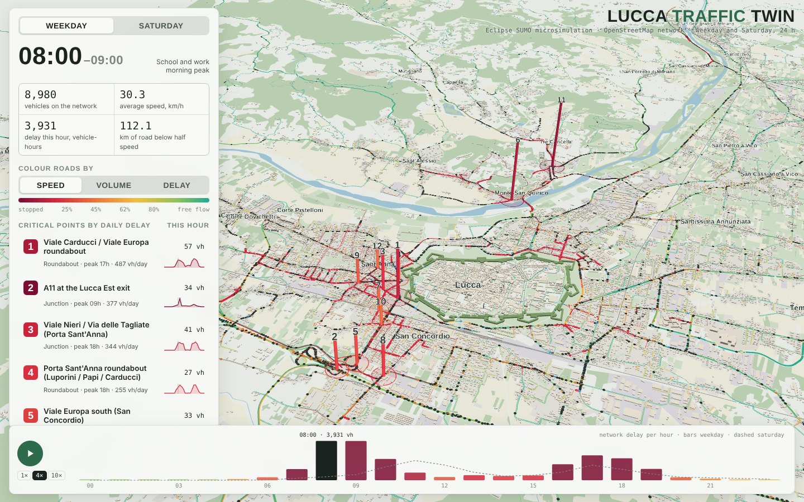
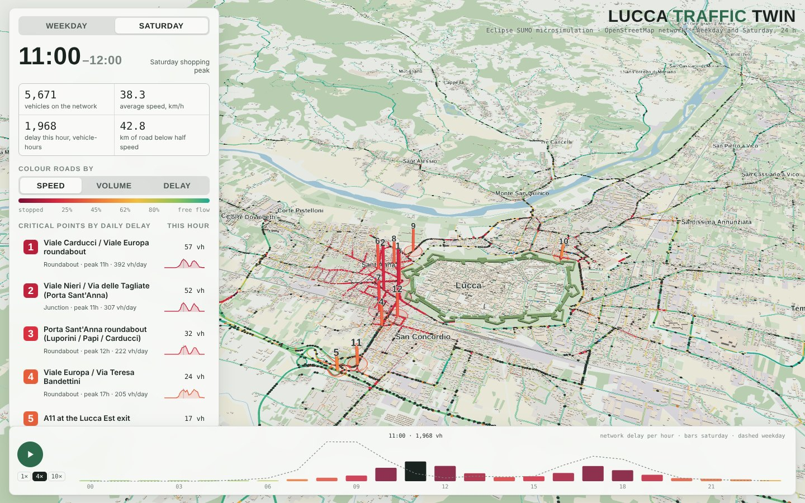
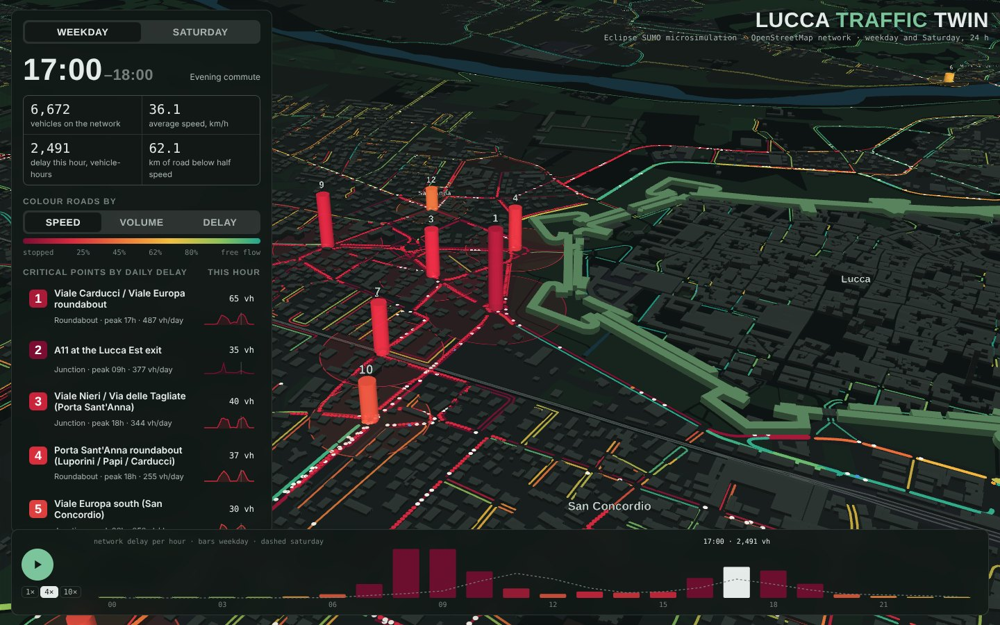
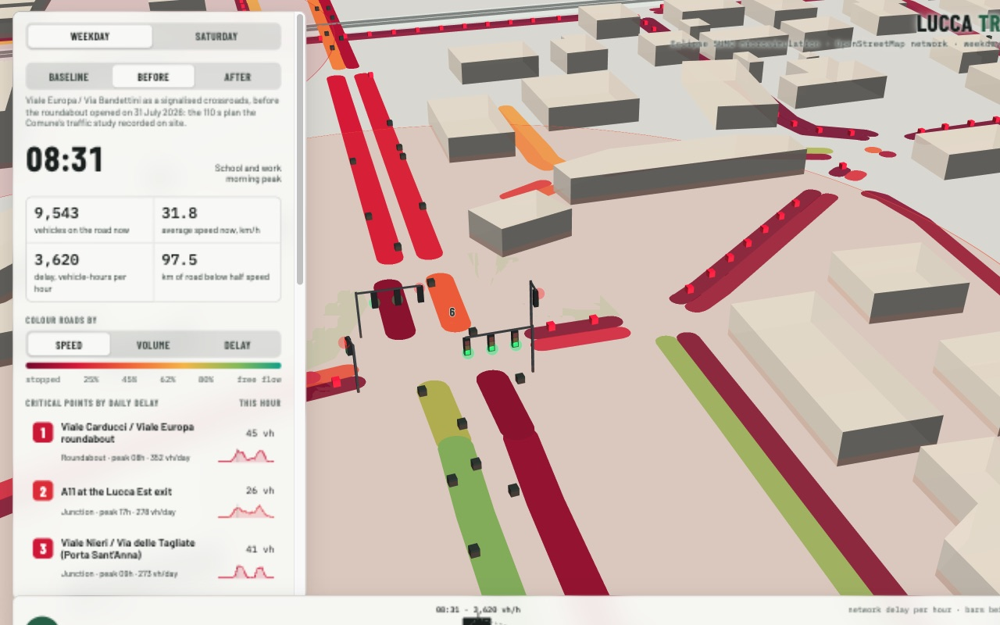
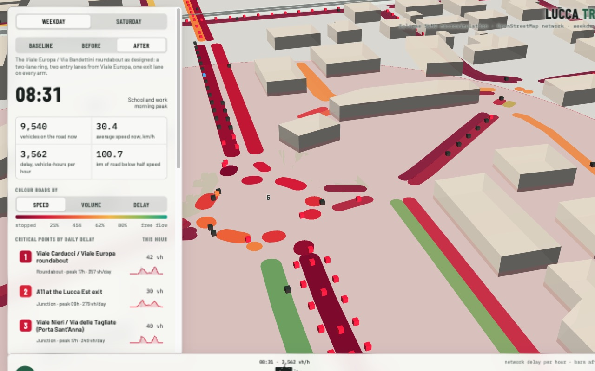
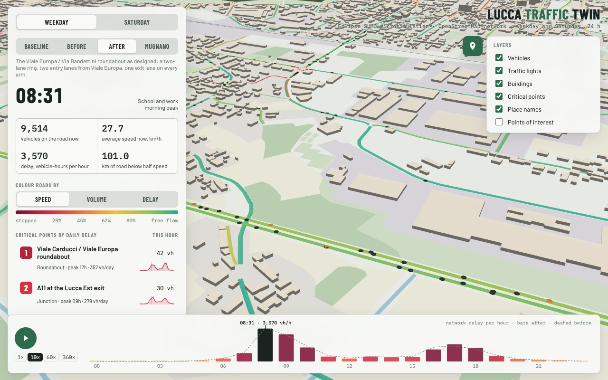
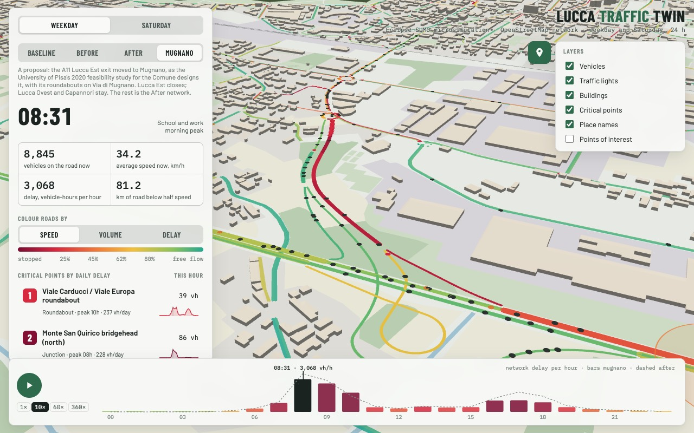
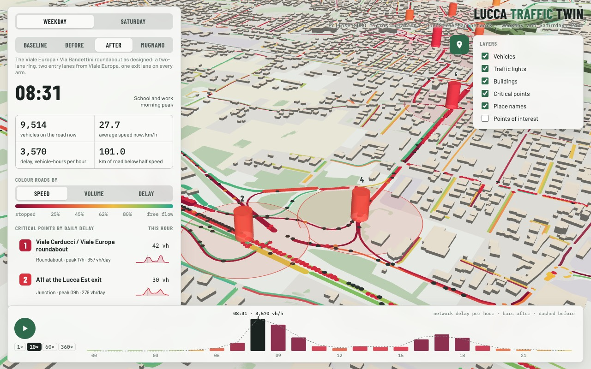
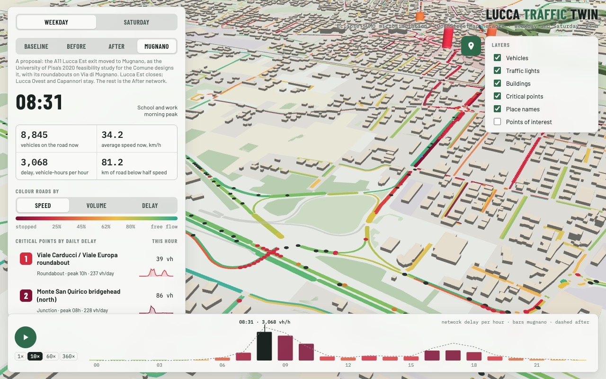

# Lucca Traffic Twin

A 3D, hour-by-hour **microsimulation of road traffic in Lucca (Italy)** and the surrounding plain, built with
[Eclipse SUMO](https://eclipse.dev/sumo/) on the real OpenStreetMap network. It simulates a typical school weekday and a
Saturday, 24 hours each, and ranks the junctions where traffic loses the most time.

**▶ Live viewer: https://mastro993.github.io/lucca-traffic-twin/**



The goal is a calibrated **baseline** for testing how traffic in Lucca could be improved: junction redesigns, new links,
signal timing, school-time staggering, parking policy. Every vehicle (about 340,000 trips on a weekday) is simulated
individually.

> This is a model, not a live traffic feed. The demand is synthetic and calibrated to the few public traffic counts
> available (see [Calibration](#calibration) and [Limits](#limits)). Rely on the ranking of critical points more than on the absolute delays.

---

## What the viewer shows

| | |
|---|---|
| **Clock** | The simulation runs as a continuous 24-hour clock at 1×, 10×, 60× or 360× real time. Traffic builds up and fades minute by minute; nothing restarts when the hour changes. At midnight the clock wraps to the start of the same simulated day, which begins with an empty network. |
| **Roads** | Coloured by speed (simulated speed ÷ speed limit), volume (vehicles/h per lane) or delay (vehicle-minutes lost per km). The hourly averages are blended as the clock moves, so colours change gradually. |
| **Vehicles** | Every simulated trip, replayed from departure to arrival along the route SUMO chose, at the times each vehicle entered and left every road. On each road a vehicle drives in a lane that leads to its next road, at its own free speed, and waits in the queue at the stop line until the second SUMO let it go, so vehicles stop at red lights and queue behind each other. Dark (light theme) or white (dark theme) = cars, orange = vans and lorries, blue = ZTL permit holders, red = crawling (under 5 km/h). **Click a vehicle to follow it**: the camera tracks it, its route is drawn, and a card shows departure, arrival, distance and speed. |
| **Traffic lights** | The 22 signals in the network (23 in the Before run), running the fixed-time plans SUMO simulated. Zoomed in, each approach has a pole with an arm over its lanes and a head per lane whose red, amber or green lamp is lit (heads are drawn at twice their real size); zoomed out, each head is a coloured dot. Hover a light for its state, the seconds until it changes and the cycle length. |
| **Critical points** | The 12 junction clusters with the most daily delay. Column height = delay at the current time; click one to fly to it at its peak hour. |
| **Points of interest** | Off by default; tick *Points of interest* in the **Layers** box on the right (the pin button pulls it out and pushes it back; closed at first on phones) to show the places that draw crowds, as dots coloured by kind: schools, hospitals and clinics, big stores and markets, sports grounds, factories and industrial sites (5000 m² or more), stations, town halls, courts, cinemas and theatres. Their names appear when zoomed in to street level; hover a dot for its name and kind. They come from OpenStreetMap, so their coverage is OSM's: the demand model does not use them. |
| **24-hour strip** | Network-wide delay per hour (bars = selected day and run; dashed = the other day, or in a scenario the run it is compared with: Before and After each other, Mugnano the After run) with the clock's playhead. Drag to scrub through the day; **Play** runs the clock. |
| **Panel** | Vehicles on the road and their average speed right now (counted from the replay), delay and km of congested road (blended hourly figures), plus the method, the calibration table and the sources. |
| **Scenarios** | The switch under the day toggle shows the baseline or one of three scenario runs: **Before**, the Viale Europa / Via Teresa Bandettini junction as the signalised crossroads it was until 30 July 2026, **After**, the roundabout that replaced it (see [Before and after](#before-and-after-the-viale-europa--via-teresa-bandettini-roundabout)), and **Mugnano**, the After network with the Lucca Est exit moved to Mugnano, as a 2020 study proposes (see [the proposal](#proposal-move-the-lucca-est-exit-to-mugnano)). Roads, signals, vehicles, critical points and figures all switch; the clock and the camera stay. |

Deep links: `?h=8` opens 08:00 (`?h=8.5` opens 08:30), `?d=sat` opens Saturday, `?s=bandettini_signals` (Before), `?s=bandettini_roundabout` (After) or `?s=mugnano_exit` (Mugnano) opens a scenario run, `?z=16` zooms in on the Viale Carducci / Viale Europa roundabout and `?ll=43.8302,10.5205` (latitude, longitude) on another place. For example, [`?d=sat&h=11`](https://mastro993.github.io/lucca-traffic-twin/?d=sat&h=11) opens the Saturday 11:00 peak.

| Saturday 11:00 | Weekday 17:00, close-up (dark mode) |
|---|---|
|  |  |

---

## Key findings (baseline)

**Weekday.**
- The network peaks at **08:00–10:00**: about 3,200 vehicle-hours are lost per hour, up to about 8,600 vehicles are on the road at once, the average speed is 31–32 km/h, and up to about 105 km of road run below half the speed limit.
- The evening peak (17:00–19:00) is milder, at about 2,000 vehicle-hours per hour.
- Over the whole day: 19,400 vehicle-hours lost and 3.0 million vehicle-km.

| # | Critical point | Control | Peak | Delay (veh-h/day) |
|---|---|---|---|---|
| 1 | Viale Carducci / Viale Europa roundabout | roundabout | 18h | 439 |
| 2 | Viale Nieri / Via delle Tagliate (Porta Sant'Anna) | priority | 19h | 316 |
| 3 | A11 at the Lucca Est exit | motorway diverge | 09h | 286 |
| 4 | Porta Sant'Anna roundabout (Luporini / Papi / Carducci) | roundabout | 08h | 249 |
| 5 | Viale Europa south (San Concordio) | priority | 08h | 244 |
| 6 | Via delle Tagliate | priority | 18h | 210 |
| 7 | Viale Giacomo Puccini / Via Alfredo Catalani | signals | 08h | 205 |
| 8 | Monte San Quirico bridgehead (north) | priority | 09h | 202 |
| 9 | Viale Europa / Via Teresa Bandettini | roundabout | 08h | 198 |
| 10 | Via Carlo Angeloni / Via Castruccio Buonamici | priority | 18h | 190 |

Also high on the list: the A11 approaching the Capannori exit and the Viale Luporini / Via San Donato roundabout.

**Saturday.** The peak is at **11:00–12:00** (about 1,600 vehicle-hours per hour). Delay concentrates on the west and south-west of the ring road around the Walls (the Viali), driven by traffic to the car parks: Carducci / Europa roundabout (368 veh-h/day), Porta Sant'Anna side streets (277), Porta Sant'Anna roundabout (213), Viale Europa / Bandettini (195), the Viale Puccini / Via Catalani signals (170).

**The pattern.** The bottlenecks cluster in three places:
1. **The south-west corner of the Viali.** Here Viale Europa, carrying traffic from the A11 Lucca Est exit, meets the ring road and the big car parks (Carducci, Palatucci, Tagliate). A 2005 University of Pisa count had already found Viale Carducci to be the most saturated approach.
2. **The Serchio crossings.** Monte San Quirico, Ponte San Pietro (SR439) and Ponte a Moriano (SS12) are the only river crossings in the area, and they meter the morning inbound flow.
3. **The A11 exits.** Lucca Est and Capannori.

---

## How it works

```
OpenStreetMap ──► netconvert ──► SUMO network ──┐
OpenMapTiles buildings + land use ──► zones ─────┼──► tour-based demand ──► SUMO 24 h microsimulation ──► edge data ──► critical points ──► web viewer
ISTAT population, traffic counts ──► calibration ┘                         (vehroutes: trip replay)
```

### Network
- **Source:** the OpenStreetMap road graph for the bbox 43.795–43.915 N, 10.420–10.620 E, about 16 × 13 km.
- **Conversion:** SUMO `netconvert` with guessed ramps, roundabouts and signals, OSM turn restrictions and lane counts. The result has about 1,700 km of road, 10,332 directed links and 4,721 junctions.
- **ZTL:** inside the Walls the network is closed to general traffic; only permit holders (`custom1`), taxis, buses and deliveries can enter.
- **Speed limits:** derived from building density, as OSM rarely tags them. 50 km/h in built-up areas, 60–90 km/h outside, 30 km/h in the ZTL, 130 km/h on the A11.
- **Traffic lights:** the 23 junction signals and 18 signalised pedestrian crossings tagged in OSM give 22 signals (netconvert joins the nodes of one junction and drops crossings it treats as plain geometry). Real signal plans are not public, so each runs a fixed-time plan with Italian standard timings:
  - a 70 s cycle (the typical urban junction cycle), split into one green stage per pair of opposite approaches, with a short left-turn stage where netconvert adds one;
  - 4 s amber, the usual urban value (the Ministry of Transport note 67906/2007 sets 3 s as the minimum and refers to 3, 4 and 5 s for approaches at 50, 60 and 70 km/h);
  - 2 s all-red between stages;
  - no coordination: each signal starts its cycle at its own fixed offset, derived from its id, so the city does not switch in step;
  - pedestrian crossings are not joined to nearby signals, otherwise netconvert gives each movement of the group its own stage. As pedestrians are not simulated, a crossing turns red for vehicles only during its amber and all-red time.

  Fixed-time plans are deterministic, so the viewer replays each light from its plan and shows exactly what the simulated vehicles obeyed: in the weekday 08:00 hour, 99.9% of the vehicles leaving a signalised approach do so on green or amber.
- **Junction fix:** right-before-left junctions are turned into priority junctions. In SUMO they otherwise block main roads, for example just after toll plazas.

### Demand
A tour-based synthetic population, `05_generate_demand.py`:
- **Residents:** about 115,000 in the study area (ISTAT, 1 Jan 2025: Lucca 89,002; part of Capannori, 46,644; part of Porcari, 8,845).
- **Homes and activities:** taken from 50,000 building volumes (footprint × height) and land use. Attraction to the walled centre is assigned to the car parks around the Walls.
- **Purposes** with Italian timing:
  - work, with 18% returning home for lunch;
  - school escort: drop-off 7:30–8:30, pick-ups around 13:00 and 16:15;
  - shopping, leisure and other trips, plus non-home-based trips.
- **Destination choice:** gravity models (exp(−β·t) on free-flow travel times between 403 zones of 700 m).
- **62 boundary gateways** with daily volumes from counts or road class:
  - commuters and visitors entering the area;
  - residents leaving it;
  - through traffic, mostly on the A11.
- **Other traffic:** vans and lorries (6% on weekdays) and ZTL permit traffic (about 5,000 transits a day, as reported by the Comune di Lucca).
- **Totals:**
  - Weekday: **339,525 trips**.
  - Saturday: **299,048 trips**, 0.88 × the weekday, which is the ratio measured at the SR439 station. Saturday has later and flatter peaks and more shopping and leisure trips.

### Simulation
- **Simulator:** Eclipse SUMO 1.28 microscopic, 1 s steps, Krauss car-following, LC2013 lane changing.
- **Route choice:** dynamic. Vehicles route on current travel times when they depart and reroute every 5 minutes, with a small penalty for low-priority roads to avoid unrealistic rat-runs. This approximates a dynamic user equilibrium without iterating.
- **Recording:** `07_run_simulation.py` writes hourly edge statistics and every vehicle's final route with the time it left each road (SUMO vehroute output with exit times), which the viewer replays.
- **Teleports:** vehicles stuck for more than 3 minutes are teleported, standard SUMO practice. This affected 1.4% of trips on the weekday and 1.1% on Saturday.
- **Trip averages:** 9.5 km and 13 min on a weekday (4.0 min lost); 9.5 km and 12 min on Saturday.

### Critical points
- **Clusters:** junctions are grouped into clusters, either roundabouts or nodes joined by links shorter than 45 m.
- **Score:** each cluster gets the vehicle-hours lost on its approach links (SUMO `timeLoss`, measured against free-flow speed).
- **Excluded:** insertion queues on boundary roads, and lane-end deadlock artefacts (near-zero speed with almost no throughput). One junction at the Lucca Ovest toll is left out of the ranking for this reason.

### Calibration
Weekday daily traffic, both directions:

| Section | Observed | Simulated | Ratio | Source |
|---|---:|---:|---:|---|
| SR439 Via Sarzanese at Ponte San Pietro | 14,500 | 16,453 | 1.13 | Regione Toscana station P058, 2019/2021 |
| SS12 Brennero, north of Lucca | 19,068 | 19,150 | 1.00 | NEPA / ANAS, 2017 |
| SR435 Via Pesciatina at Antraccoli | 15,272 | 11,918 | 0.78 | NEPA / ANAS, 2017 |
| Viale Europa, Capannori (busiest section) | 21,062 | 15,236 | 0.72 | NEPA / ANAS, 2017 |
| Via Romana, east (busiest section) | 24,140 | 22,174 | 0.92 | NEPA / ANAS, 2017 |

- The simulated peak-hour shares are 7.5–10% of daily traffic; the stations measured 8.2–9.5%.
- The eastern corridors (Capannori) are underestimated by about 25%.
- All counts are in [`data/counts/counts.json`](data/counts/counts.json).

---

## Repository layout

```
data/
  osm/lucca_roads.osm.gz      OSM roads, rail, walls, parking (Overpass, 11 Oct 2026)
  osm/lucca_poi.json.gz       OSM points of interest with their outlines (Overpass, 12 Oct 2026)
  osm/lucca_omt_z14.bin       OpenMapTiles z14 tiles: buildings with heights, land cover, water (OpenFreeMap)
  counts/counts.json          observed traffic counts and population used for calibration
network/
  lucca.net.xml.gz            final SUMO network
  patches/                    ZTL, speed-limit and junction patches applied by netconvert
demand/
  weekday.trips.xml.gz        339,525 trips (exactly the demand used for the results)
  saturday.trips.xml.gz       299,048 trips
results/
  weekday/, saturday/         hourly edgeData (SUMO meandata) and run statistics (tripinfo and vehroutes are not committed)
  *_results.json              hourly KPIs and ranked critical points
  calibration.json, run_stats.json
  scenarios/<name>/<day>/     scenario runs and their comparison with the baseline (not committed unless worth keeping)
scenarios/<name>/             network changes to test, as netconvert patch files (see Scenarios)
scripts/                      the pipeline (01–12), shared helpers and diagnostics
src/                          the web viewer (Vite + React + TanStack Router/Query, deployed to GitHub Pages)
public/data/                  packed viewer data written by steps 6, 10 and 11
docs/assets/                  README screenshots
run_pipeline.sh               runs everything end to end
```

## Reproduce

```bash
pip install -r requirements.txt            # includes the SUMO binaries (eclipse-sumo)
SIMULATE=0 ./run_pipeline.sh               # rebuild network, demand, viewer data from the committed inputs (~5 min)
./run_pipeline.sh                          # ... and re-run both 24 h simulations (about an hour each, in parallel)
DOWNLOAD=1 ./run_pipeline.sh               # also re-download OSM and building tiles first
pnpm install && pnpm dev                   # open http://localhost:5173/lucca-traffic-twin/
```

The pipeline is deterministic. With fixed random seeds, the committed network and trip files are reproduced exactly from `data/osm/`.

| Step | Script | Output |
|---|---|---|
| 1 | `01_download_osm.py` | OSM roads from Overpass, in 12 tiles (one big query times out), then the points of interest |
| 2 | `02_download_tiles.py` | OpenFreeMap z14 vector tiles |
| 3 | `03_build_network.py` | `network/lucca.net.xml.gz` + patches |
| 4 | `04_build_zones.py` | zones, trip-end weights, gateways, travel-time matrix |
| 5 | `05_generate_demand.py <day> [scale]` | `demand/<day>.trips.xml.gz` |
| 6 | `06_export_static.py` | viewer scene: buildings, land cover, walls, roads, points of interest |
| 7 | `07_run_simulation.py <day> [trips]` | `results/<day>/`: edge data, statistics, tripinfo, vehroutes |
| 8 | `08_export_results.py <day> [scenario]` | per-edge hourly metrics, KPIs, critical points, trip replay; with a scenario, its run for the viewer's switch |
| 9 | `09_check_counts.py` | `results/calibration.json` |
| 10 | `10_build_summary.py` | `public/data/summary.json` |
| 11 | `11_pack_web.py` | `public/data/*.b64.txt` |
| 12 | `12_scenario.py <name> <day>` | `results/scenarios/<name>/<day>/`: a scenario run and its comparison with the baseline |

### Scenarios
A scenario changes the road network and is compared with a reference run of the unchanged network. It is a folder
`scenarios/<name>/` of [netconvert patch files](https://sumo.dlr.de/docs/Networks/PlainXML.html), applied on top of
`network/lucca.net.xml.gz`, using the ids in that file:

| File | Changes | Example |
|---|---|---|
| `*.tll.xml` | signal plans | `<tlLogic id="248886555" type="static" programID="0" offset="64">` with its `<phase>`s |
| `*.nod.xml` | junctions | `<node id="…" type="traffic_light"/>` (the network's standard 70 s plan unless a `*.tll.xml` gives one), `type="priority"`, new nodes with `x`, `y` |
| `*.edg.xml` | roads | `<edge id="…" numLanes="2" speed="8.33"/>`, `disallow="passenger"`, `<delete id="…"/>`, new roads with `from`, `to`, `<roundabout nodes="…" edges="…"/>` |
| `*.con.xml` | turning movements | `<connection from="…" to="…"/>`, `<delete from="…" to="…"/>` |
| `<day>.trips.xml.gz` | demand (optional) | replaces `demand/<day>.trips.xml.gz` |
| `areas.json` | areas to report (optional) | `{"Viale Europa": {"name": "^Viale Europa$", "bbox": [43.828, 10.485, 43.8405, 10.5]}}` |

Vehicles choose their route when they depart and every 5 minutes, so traffic finds its own way through the changed network.
A scenario can build on another by linking to its files: `mugnano_exit` links the as-built Bandettini roundabout's
(`ln -s ../bandettini_roundabout/roundabout.edg.xml`), so it changes the network as it is today. An existing road can be
moved onto new junctions (`<edge id="…" to="…" shape="…"/>`); netconvert then drops its connections at that end, so
the scenario's `*.con.xml` must give them again.

```bash
python3 scripts/12_scenario.py baseline weekday                   # the reference run, once per day type (~1 h)
python3 scripts/12_scenario.py puccini_signals weekday            # build, simulate 24 h, compare with the reference
END=36000 python3 scripts/12_scenario.py puccini_signals weekday  # until 10:00 only, compared over the same hours
SEED=2 python3 scripts/12_scenario.py puccini_signals weekday     # another random seed (run the baseline with it too)
COMPARE=1 python3 scripts/12_scenario.py puccini_signals weekday  # compare an existing run again
BASE=other python3 scripts/12_scenario.py puccini_signals weekday # compare with the run of scenario `other` instead
python3 scripts/tools/seed_summary.py puccini_signals weekday     # the comparisons of every seed run, side by side
```

The comparison prints and writes to `comparison.json` (`comparison_vs_<other>.json` with `BASE`) the time lost,
vehicle-km and vehicles on the road per hour, the trip statistics (full-day runs only) and the roads where time lost
changed most. These totals include every road, also the boundary insertion queues the critical-point ranking leaves out.
With an `areas.json`, the same totals are given for each area: a road belongs to an area when it meets all of the
area's criteria, `"near": [lat, lon, metres]` (comes that close to the point), `"bbox": [south, west, north, east]` (its
midpoint is inside) and regular expressions on its `"name"`, SUMO `"type"` (`highway.primary`, …) or the OSM `"ref"` of
one of its ways (`"^SS12$"`; plain `SS12` also matches `SS12radd`). The edge data leaves out the inside of junctions,
which matters when the scenario changes a junction's size (a roundabout's ring is mostly junction): judge a junction
redesign on time lost rather than vehicle-km there, on the trip statistics, and on `scripts/tools/junction_times.py`,
which times the vehicles through the junction from their routes (arms in the scenario's `junction.json`).

**Compare like with like.** The reference is the scenario `baseline` (an empty folder) rather than the committed
`results/<day>/`, and SUMO runs on a single thread. With two threads, as the committed baseline was run, two runs of the
same network differed by 11% in daily time lost, more than most changes are worth; on one thread a run is repeated
exactly. Any change still reshuffles which vehicle gets which random speed, so repeat a promising scenario with a few
`SEED`s (and the baseline with each) before trusting a difference of a few per cent.

`scenarios/puccini_signals` is a worked example: the signals of critical point 7 on a 90 s cycle instead of 70 s. On one
seed it cut the time lost on the junction's four approaches by 3% (188 to 183 veh-h a day), while the network total
moved by +1.9% and single hours by up to ±30% on roads kilometres away: one changed light reshuffles the whole run, which
is why a single seed cannot settle a result.

Before a full run, use `scripts/tools/route_volumes.py weekday` for a 3-minute free-flow check against the counts.

#### Before and after: the Viale Europa / Via Teresa Bandettini roundabout

On 31 July 2026 the signalised crossroads of Viale Europa (the SS12 radd. from Pisa, and the road from the A11 Lucca Est
exit to the Walls) and Via Teresa Bandettini became a roundabout. The OSM extract, and so the baseline, already has the
roundabout, so two scenarios rebuild the junction as it was and as it was built:

| Scenario | Junction | Sources |
|---|---|---|
| `bandettini_signals` | the crossroads as mapped until 30 July 2026, with a 110 s fixed-time plan: northbound only (10 s), Viale Europa both ways (50 s), southbound with its left turn (30 s), Via Bandettini (20 s) | OSM history (signal node 1686445825); the Comune's traffic study ([PT 60-2024](https://allegatiatti.comune.lucca.it/Anno%202026/Rotatoria_Viale_Europa-PE/PDF/01_AMBITO%20GENERALE/), Aleph Progetti), Table 4.1 and Figures 4.8–4.11 |
| `bandettini_roundabout` | the roundabout as designed: a two-lane ring 26 m across at its centreline (30 km/h), two entry lanes from Viale Europa, one from Via Bandettini, one exit lane on every arm | the executive project PT 60-2024 (ellipse 44 × 35 m, ring 8.5–9.5 m wide); the project engineer: "due corsie d'ingresso … e solo una di uscita" |

The baseline's own roundabout is not used for the comparison. OSM gives its entries and exits the old crossroads' 3–4
lanes, draws the west flare the wrong way round and packs the ring into links shorter than a car, and in SUMO it locks
up in the peaks: the old signals beat it by 7–15% in the network's daily time lost (three seeds, weekday).

```bash
python3 scripts/12_scenario.py bandettini_signals weekday                              # before (and against the baseline)
BASE=bandettini_signals python3 scripts/12_scenario.py bandettini_roundabout weekday   # after, compared with before
SEED=2 python3 scripts/12_scenario.py bandettini_signals weekday                       # ... repeat both with SEED=2 and 3
python3 scripts/tools/seed_summary.py bandettini_roundabout weekday bandettini_signals
HOURS=8,17 python3 scripts/tools/junction_times.py bandettini_roundabout weekday bandettini_signals
```

**Results** (roundabout against signals, change in daily time lost, mean of three seeds and their range; `areas.json`
holds the areas; the runs' `stats.xml` and comparisons are in `results/scenarios/`, their edge data and routes are not
committed):

| | Weekday | Saturday |
|---|---:|---:|
| Whole network (trip statistics) | −3.6% (−7.4 to −0.5) | −7.7% (−12.3 to −1.4) |
| The junction: 200–400 m before it to just past it, inside included (`junction_times.py`) | −5.4% (−11.7 to +0.5) | −17.4% (−28.1 to −6.4) |
| Teresa Mattei roundabout, Viale Carducci / Viale Europa (100 m) | −4.1% (−14.0 to +2.2) | −8.6% (−12.2 to −2.5) |
| Viale Europa (SS12 radd.), Via Nuova per Pisa to the junction | −6.1% (−7.3 to −4.7) | −9.5% (−16.5 to −4.2) |
| Viale Europa, the junction to Teresa Mattei (300 m) | +25.4% (+18.9 to +32.5) | +15.5% (+4.8 to +28.4) |
| SS12 radd., Via Nuova per Pisa | +0.6% (−7.4 to +9.1) | −5.6% (−11.7 to +1.2) |
| SS439 west, Via Sarzanese and Viale Puccini | −3.2% (−10.7 to +3.0) | +1.3% (−0.6 to +4.9) |
| West Lucca, west of the Walls, without the motorway | −8.8% (−17.8 to −2.4) | −16.2% (−25.4 to −2.3) |

- **At the junction** the roundabout trades Viale Europa's time for Via Bandettini's. With the 14 s of green the old
  plan gave it, Bandettini traffic took 10–13 minutes from 200–400 m out to past the junction in the weekday peaks; with
  the roundabout its two arms carry 36–75% more vehicles a day, in 37–54% less time. Viale Europa, which had 60–80 s of
  the 110 s cycle, now gives way to them: in the weekday peaks its approaches are slower (from the south at 08:00, 270 s
  to 396 s; from the north at 17:00, 56 s to 112 s) and pass 10–20% fewer vehicles an hour. Over a weekday the
  junction's total time falls 5%; on Saturday, with no sharp peaks, 17%.
- **Beyond the junction** one stretch loses time in every seed: the 300 m of Viale Europa between the junction and the
  Teresa Mattei roundabout, in both directions (about +40 veh-h on a weekday, +20 on Saturday, as much as Viale Europa
  saves south of the junction). Northbound traffic now reaches Teresa Mattei in a steady stream instead of in platoons
  from the lights, and southbound traffic queues to enter the roundabout. The Teresa Mattei roundabout itself, Via Nuova
  per Pisa and SS439 move within the spread of the seeds, mostly down, and the west of Lucca as a whole loses 9–16%
  less time. Among single roads, Via delle Tagliate Seconda near Porta Sant'Anna also loses more in every seed (+20%),
  but with three seeds one road in four agrees on the sign by chance, so single roads far from the junction are weak
  evidence.
- **Where traffic moves:** about 1,500 vehicles a day stop crossing on Viale Europa (−5%) and Via Bandettini takes about
  1,000 more. Via delle Tagliate, which feeds the west arm, carries 17% more vehicle-km and Viale Puccini 1–3% more, with
  no more time lost on either; the nearby side streets Via Ungaretti (−22%) and Via di Sant'Anna (−9%) carry less.
- **Calibration:** against the Comune's radar counts (January 2025, signals still in place) the "before" run carries
  1.09× and 1.29× the traffic on Viale Europa south of the junction, 1.15× on the overpass, 0.78–1.00× on Viale Carducci
  and 0.65–0.72× on Via Bandettini.

Limits: pedestrians are not simulated, and at the roundabout they cross on zebras at every entry and exit, which would
slow it in reality; the demand is the same in both runs (no traffic attracted or put off by the change, no change of
departure time); the old plan is the one the traffic study recorded on site in January 2025, and it may have run other
programmes at other times of day. The "before" run's waits on Via Bandettini are longer than the study's own model found
(level of service F, i.e. over 80 s of delay), so the gain there may be overstated. The edge data leaves out the inside of
the roundabout, so the West Lucca figures count about 60 veh-h a day of waiting at the old stop lines that, with the
roundabout, partly moves onto the ring; the junction row, from the vehicle routes, counts it.

**In the viewer**, the Before and After switch replays the first seed of both scenarios, so a single hour there also
differs by chance; the table above averages three seeds. After re-running them, `python3 scripts/08_export_results.py
<day> <scenario>` for each day and scenario, then steps 10 and 11, update the viewer (`run_pipeline.sh` does this for
every scenario whose run is in `results/scenarios/`). To show another scenario, add it to `VIEWER_SCENARIOS` in
`scripts/common.py` and give it a label and a note in `RUNS` in `10_build_summary.py`, then re-run step 6 first: the
scene holds the roads and signals of every run.

| Before: the signalised crossroads, weekday 08:31 | After: the roundabout, same time |
|---|---|
|  |  |

#### Proposal: move the Lucca Est exit to Mugnano

Between Lucca Est and Capannori the A11 runs for 8.5 km without an exit. Lucca Est, 2 km from the Walls, lets its
traffic out onto Viale Europa, which leads to the south-west corner of the Viali where the model's worst delays are
(critical points 1, 3 and 5), and traffic from Florence bound for the east and south-east of the city leaves at
Capannori and crosses the plain. The Comune's structural plan (Piano Strutturale, 2017) keeps a corridor free along the
motorway at Mugnano, on the border with Capannori, for a new exit, and in 2020 the University of Pisa studied it for the
Comune: [*Studio per la verifica di fattibilità di un nuovo casello autostradale (A11) in località
Mugnano*](https://maps3.ldpgis.it/lucca/sites/lucca/files/po/quadro_conoscitivo/QC_S/QC_Sa_1.pdf) (Laboratorio LOGIT, A.
Pratelli, November 2020), part of the Piano Operativo's specialist studies with its [compensation
measures](https://pianooperativovigente.comune.lucca.it/QC_Quadro%20Conoscitivo/QC.S_studi_specialistici/QC.Sa.2_Approv_Def_signed.pdf).
The study argues from motorway safety: the ramps of Lucca Est and of the Lucca Ovest / A12 junction are 190 m apart, and
traffic weaving between them causes rear-end collisions. Its plan moves Lucca Est to Mugnano: the new exit opens and Lucca
Est closes, its toll becoming a car park for motorway users, so the city keeps two exits, Lucca Ovest and Mugnano. The
study measured the motorway, not the city's roads, which is what the model can add.

The scenario `mugnano_exit` builds the study's plan on the network as it is today, with the as-built Bandettini
roundabout (its folder links to that scenario's patch files), and is compared with `bandettini_roundabout`:

| Element | In the model | Source |
|---|---|---|
| Trumpet junction north of the A11, west of the Fabio Perini plant: direct ramps from and to Florence, a loop south of the motorway and a flyover for traffic from Pisa, a hook onto the motorway for traffic to Pisa | ramps at 40 km/h, as at Lucca Est; a third lane for 150–230 m before each exit and after each entry | study, §3.1.2 and Figures 28–30 |
| Toll plaza, five lanes each way | the road's 100 m stretch through it at 40 km/h; toll booths are not simulated, as at the other exits | study, §3.1.2 |
| Roundabout 40 m across on Via di Mugnano at Via Dario Vitali, the exit road its fourth arm | two-lane ring, two entry lanes from the exit | study, §3.1.2 and Figure 31 |
| Roundabout at Via di Mugnano / Via Giovanni Diodati, Via Diodati as the lorry route, traffic calming through the village | one-lane ring; the roads linking the exit upgraded to tertiary roads; Via di Mugnano through Mugnano at 30 km/h | study, Figure 31; compensation measures |
| Lucca Est closed to general traffic, kept as a car park for motorway users with buses to the city | its toll plaza removed, so its ramps lead nowhere; the car park is not modelled | study, §3.2 |
| The Via di Mugnano / Via Squaglia / Via Mattei junction, where the exit's traffic meets the roads to the city | rebuilt 40 m across with a two-lane ring, instead of the 18 m mini-roundabout OSM maps | added here: with the OSM one, the exit's traffic to the city queued back onto the ramps every morning |
| Not included | the two roundabouts east of Via Diodati, which prepare for the Piano Operativo's future roads, and the Piano Operativo's link road along the railway to the station | |

```bash
python3 scripts/12_scenario.py bandettini_roundabout weekday                            # the network as it is today (committed)
BASE=bandettini_roundabout python3 scripts/12_scenario.py mugnano_exit weekday          # the plan, against today
SEED=2 BASE=bandettini_roundabout python3 scripts/12_scenario.py mugnano_exit weekday   # ... and SEED=2 and 3, also on Saturday
python3 scripts/tools/seed_summary.py mugnano_exit weekday bandettini_roundabout
```

**Results** (change in daily time lost against the network as it is today, mean of three seeds and their range; the
areas, in `scenarios/mugnano_exit/areas.json`, overlap, and West Lucca includes Lucca Est, Viale Europa and Teresa
Mattei; the runs' `stats.xml`, comparisons and edge data are in `results/scenarios/mugnano_exit/`):

| | Weekday | Saturday |
|---|---:|---:|
| Whole network (trip statistics) | −16.2% (−18.7 to −15.0) | −17.2% (−24.4 to −11.0) |
| The new exit's roads, 400 m round the junction (veh-h a day) | 21 → 315 | 11 → 125 |
| Lucca Est exit and its ramps (300 m) | −90.3% (−90.6 to −89.9) | −85.7% (−86.3 to −84.9) |
| Viale Europa (SS12 radd.), Lucca Est to the Walls | −64.2% (−65.4 to −62.9) | −68.7% (−72.6 to −65.9) |
| Teresa Mattei roundabout, Viale Carducci / Viale Europa (100 m) | −34.3% (−35.6 to −33.4) | −41.6% (−48.8 to −34.9) |
| The Viali round the Walls | −19.6% (−22.0 to −17.5) | −20.0% (−26.4 to −12.5) |
| San Concordio: Viale San Concordio, Via Savonarola, Formica, Consani, Squaglia, Ingrellini | −25.6% (−33.5 to −16.6) | −2.3% (−23.6 to +13.5) |
| South-east Lucca, the railway to the A11 | +60.6% (+49.2 to +69.2) | +54.0% (+15.5 to +92.7) |
| West Lucca, west of the Walls | −28.5% (−32.9 to −25.5) | −36.0% (−48.3 to −25.8) |
| East Lucca and Capannori | +3.5% (+2.0 to +4.6) | +4.9% (+2.7 to +7.0) |
| Capannori exit and its ramps (300 m) | −29.1% (−30.3 to −27.9) | −20.1% (−21.2 to −19.5) |
| A11, Lucca Ovest junction to the Capannori exit | −14.0% (−17.3 to −10.7) | −9.2% (−12.9 to −5.6) |
| A11 east of the Capannori exit, toward Florence | −71.8% (−73.2 to −69.2) | −8.1% (−10.8 to −4.8) |

| Vehicles a weekday leaving or joining the A11 (first seed) | Today | With the plan |
|---|---:|---:|
| Lucca Ovest (on the A11 / A12 link road) | 8,500 | 10,900 |
| Lucca Est | 25,700 | – |
| Mugnano | – | 27,900 |
| Capannori | 28,000 | 25,300 |

- **The network** loses 16% less time on a weekday, 3,200 vehicle-hours a day or 35 s a trip, and 17% less on
  Saturday, in every seed, while driving 1% fewer vehicle-km. With Lucca Est closed, Viale Europa no longer carries the
  motorway's traffic: it loses 64–69% less time and carries 22–26% fewer vehicle-km, the Teresa Mattei roundabout loses
  34–42% less time, the Viali about 20% and the west of the city as a whole 29–36%. Traffic between Florence and the east
  and south of the city now stays on the motorway to Mugnano, so on a weekday the morning queue for the Capannori exit,
  which in the model backs up toward Florence, falls from 650 to 180 vehicle-hours.
- **The cost falls on the south-east.** Mugnano handles 27,900 vehicles a weekday, more than Lucca Est did, and the
  south-east of the city between the railway and the motorway carries 64–85% more vehicle-km and loses 54–61% more time.
  The exit's own roads lose 315 vehicle-hours a weekday, most of them in the morning peak, when 1,000 vehicles an hour
  leave the motorway there: most head north for the city by Via di Mugnano and the Via Ingrellini underpass under the
  railway, and they queue back from the rebuilt junction at Via Squaglia to the toll plaza. The Piano Operativo's planned
  link road along the railway would give them a second way in. The San Concordio streets carry 16–26% more traffic, in
  less time lost on a weekday; Lucca Ovest takes 2,400 more vehicles a weekday, and East Lucca and Capannori lose 3–5%
  more time.

Limits: tolls are not simulated (see [Limits](#limits)), so a short trip on the motorway costs nothing: about 6,700
vehicles a weekday drive the 5 km between Mugnano and Capannori on the A11, where today's run has 5,700 between Lucca
Est and Capannori, and the model's Lucca Est carries more traffic than the study counted there, so the relief of
closing it may be overstated. The demand is the same in every run: no traffic is attracted by the new exit, for instance
to the industrial areas around it, and no driver parks at the Lucca Est car park and takes the bus. Toll booths and
pedestrians are not modelled, and the junction is drawn from the study's schematic plans, within about 50 m.

**In the viewer**, the **Mugnano** run replays the first seed of `mugnano_exit`, and the 24-hour strip draws the After
run dashed beside it; [`?s=mugnano_exit&h=8.5&ll=43.8302,10.5205`](https://mastro993.github.io/lucca-traffic-twin/?s=mugnano_exit&h=8.5&ll=43.8302,10.5205)
opens the new junction at 08:30.

| The network today (After), weekday 08:31 | With the plan, same time |
|---|---|
|  |  |
|  |  |

### Viewer
The viewer (`src/`, `index.html`, `package.json` at the repository root) is a [Vite](https://vite.dev) + React + TypeScript app (pnpm), rendering with [deck.gl](https://deck.gl) 8.9.
[TanStack Router](https://tanstack.com/router) parses the deep links and loads the data before the first frame,
[TanStack Query](https://tanstack.com/query) caches the data files, and [TanStack Store](https://tanstack.com/store) shares the UI state
between the panels and the render loop.

- `src/lib/engine.ts`: the deck.gl scene and its animation loop (clock, vehicle replay, follow camera, picking).
- `src/lib/layers.ts`: the deck.gl layers for each frame.
- `src/lib/signals.ts`: the traffic light state at any clock time, from the fixed-time plans.
- `src/lib/data.ts`, `src/lib/trips.ts`: data loading and decoding.
- `src/lib/replay.ts`: where each vehicle is between the exit times SUMO recorded: lanes, queues, junction crossings.
- `src/components/`: the control panel, the 24-hour strip and the overlays.

```bash
pnpm dev        # dev server
pnpm test       # unit tests (Vitest)
pnpm build      # type-check and build to dist/
```

Every push to `main` that touches the viewer builds the site and deploys it to GitHub Pages (`.github/workflows/pages.yml`).

### Viewer data format

**Binary files.** They are stored as gzip + base64 text so the same page also works on hosts that only serve text:
- `static`: typed arrays for buildings, ground, roads and walls, indexed in `static.json`. Roads are drawn along the middle of their lanes; `move_from`, `move_to` and `move_lanes` list, for each pair of consecutive roads, the lanes of the first (a bit mask, bit 0 = rightmost) that lead to the second.
- `<run>_edges`: uint8 speed ratio, uint16 flow, delay and density per edge and hour. `<run>` is `wd` or `sat` for the baseline, `wd-<scenario>` or `sat-<scenario>` for a scenario of the run switch.
- `trips/<run>_HH`: the `LTR1` trip replay, one file per hour holding every vehicle on the road during that hour, so any clock time needs a single file. A 16-byte header (magic, vehicles, route edges, hour start), then per vehicle the uint32 departure second and the uint16 route length; per route edge a uint16 road index and the uint16 seconds since the previous exit; finally per vehicle the type and the departure and arrival positions on their edges (uint8, 0–255 of the edge length). The viewer rebuilds the motion in between the way [MATSim](https://matsim.org) draws its queue snapshots. On each road a vehicle drives in a lane that leads to its next road, at its free speed (the speed limit times its own speed factor, estimated from its fastest roads), until it reaches the back of the queue of vehicles that entered the lane before it and leave first; it waits there, moving up as they leave (each gives up its place over its last 2 s), until its own exit time, then crosses the junction in a straight line. A vehicle that took at most 3 s, or 25%, longer than its free-flow time on a road (whichever is more) drives it at a steady speed instead. SUMO only lets a vehicle leave a signalised approach on green or amber, so the replayed vehicles stop at red lights.

**Traffic lights** are in `static.json` under `tls`: `prog` holds each signal's plan (offset and `[seconds, state]` phases, one SUMO state letter per controlled link), `heads` one head per controlled lane (signal index, link indices, stop-line position, heading in degrees clockwise from north) and `poles` one pole per approach (signal index, position, heading, arm reach in metres). A head shows green if any of its links has `G` or `g`, amber for `y`, red otherwise.

**Points of interest** are in `static.json` under `poi`: name (empty if OSM has none), category (`edu`, `health`, `shop`, `sport`, `work`, `civic`), kind (`Supermarket`, `Factory`, …) and position. `POI_KINDS` in `06_export_static.py` maps OSM tags to them; a site OSM maps twice (its grounds and a building on them) keeps one point.

**Runs.** The scene holds the roads and signals of every run: the baseline's first, so their indices never change, then
those only a scenario's network has. A scenario's changed signal is a signal of its own. `static.json` lists under
`absent`, for each run (`base` or the scenario's name), the road and signal indices its network lacks, and the viewer
hides them. `summary.json` lists the switch's runs under `runs` (id, label, note, and `vs`, the run the strip draws
dashed) and their KPIs and critical points under `scen`, by file prefix (`wd-<scenario>`).

**Coordinates** are local metres in the SUMO/UTM frame, relative to Piazza San Michele.

---

## Limits

- **Sparse, dated counts.** There are five calibration sections, from 2017–2021; the eastern corridors run about 25% low. More counts (Comune / Provincia, A11 toll data) would improve the model.
- **Signal plans** are not public. Fixed-time plans with standard Italian timings are used (see [Network](#network)); real plans may be actuated, coordinated or switch to flashing amber at night. OSM tags only 23 signalised junctions in the area.
- **Not modelled:** buses, bicycles, pedestrians, parking search, roadworks, incidents and events (Lucca Comics & Games, Summer Festival).
- **Fixed departure times.** Without departure-time choice, peaks are probably sharper than in reality, so the 08–10 congestion is on the strong side.
- **Replayed motion.** Only the second each vehicle left each road is recorded, not its lane or its speed along the road, so the viewer reconstructs both (see [Viewer data format](#viewer-data-format)). Delay shows as standing in queues rather than as slow driving, and where SUMO let a vehicle pass another in a lane the replay may briefly draw them overlapping.
- **No tolls.** Toll booths and fares are not simulated, so drivers choose motorway exits by travel time alone and short trips on the A11 between Lucca's exits cost nothing: in the run of today's network about 5,700 vehicles a weekday drive between Lucca Est and Capannori on it. At 18:00 the model sends 660 vehicles an hour onto the A11 westbound at Lucca Est, where the University of Pisa's study counted 10, and lets out 280 of the 735 counted arriving from Florence (counts of 2010; see [the Mugnano exit](#proposal-move-the-lucca-est-exit-to-mugnano)). Which exit traffic uses is the model's weakest output.
- **Model artefacts.** Some delay at the A11 boundaries comes from vehicles waiting to enter the study area, and a few short multi-lane links deadlock until teleported. Both are excluded from the KPIs and the ranking.

## Roadmap: improvement scenarios

- [ ] **Ring road, south-west:** Carducci / Europa roundabout redesign, signal coordination on the Viali, access management for the Carducci / Palatucci / Tagliate car parks.
- [ ] **Park-and-ride at Lucca Est** with a shuttle to the Walls.
- [ ] **The planned "Assi viari" / Viabilità Est** (Ponte a Moriano – A11 Frizzone / Lucca Est) and a new Serchio bridge.
- [x] **The Lucca Est exit moved to Mugnano**, the University of Pisa's 2020 plan (see [the proposal](#proposal-move-the-lucca-est-exit-to-mugnano)).
- [ ] **Ramp metering or toll-plaza layout** at Lucca Est and Capannori, and **tolls** in route choice.
- [ ] **Demand-side measures:** staggered school starts (8:00 / 8:30), modal shift for school trips, Saturday parking guidance.
- [ ] **Difference maps** in the viewer: colour each road by its change between two runs (the run switch shows one run at a time).

## Data access notes
- Overpass rejected the single large query (HTTP 504), so the extract was downloaded in 12 tiles and merged (`merge_osm.py`).
- Building footprints with heights come from OpenFreeMap's OpenMapTiles z14 tiles rather than raw OSM. They are lighter, and their `render_height` values give consistent 3D heights.

## Credits

- Map data © [OpenStreetMap contributors](https://www.openstreetmap.org/copyright) (ODbL).
- Buildings and land cover from [OpenFreeMap](https://openfreemap.org) / [OpenMapTiles](https://openmaptiles.org).
- Traffic counts:
  - [Regione Toscana](https://dati.toscana.it/dataset/sr439) (CC BY-SA);
  - [NEPA / ANAS, Viabilità Est di Lucca](https://va.mite.gov.it/File/Documento/341806);
  - [University of Pisa, Porta Sant'Anna study](https://docenti.ing.unipi.it/~dic/ingegneria_civile/bacheca/doc_pubblici/atti_lucca_21_2210208/10_pratelli_etc.pdf);
  - [Comune di Lucca, PUMS monitoring 2024](https://comune.lucca.it/app/uploads/2025/02/Documento-di-Monitoraggio2024.pdf).
- Population from ISTAT.
- Simulation by [Eclipse SUMO](https://eclipse.dev/sumo/) (EPL-2.0). Rendering by [deck.gl](https://deck.gl) (MIT).

## Licence

Code: [MIT](LICENSE). Data derived from OpenStreetMap stays under the ODbL; see [DATA_LICENSE.md](DATA_LICENSE.md).
